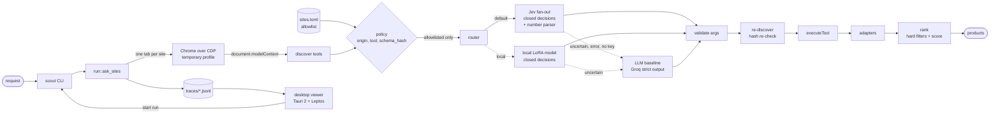
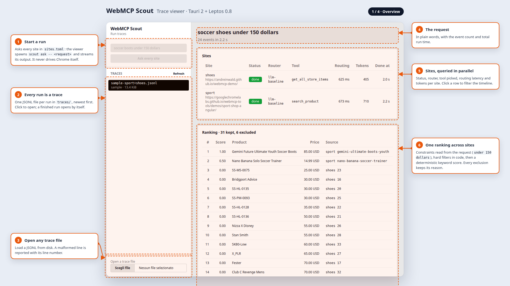

# WebMCP Scout

**Rust agentic browser runtime for [WebMCP](https://webmachinelearning.github.io/webmcp/): one shopping request, several sites, typed tool calls.**

Sites that support WebMCP register *tools* for AI agents through `document.modelContext`: a shop can expose a `search_products` tool with typed arguments instead of a page to scrape. WebMCP Scout drives Chrome over CDP, reads those tools on every site in `sites.toml`, turns a natural-language request into a tool call with the right arguments, runs it, and ranks the products from all sites together.

```sh
scout ask "football boots under 150 dollars"
```

Choosing the tool and its arguments is the **routing** step. By default it goes to **Jev**, with an LLM as the fallback:

| Router | How it decides | Status |
|---|---|---|
| `fanout` | **Jev** (TypeSafe) answers the closed decisions in one request: whether to act, which tool, enum values, booleans, whether an optional argument was given. Numbers are parsed in code; the LLM fills only free text | **default** |
| `baseline` | One LLM call with strict structured output (Qwen 3.8 27B through an OpenAI-compatible API, Groq by default) picks the tool and every argument | **fallback**, or on its own with `--router baseline` |
| `hybrid` | Like `fanout`, but Jev is asked in two stages: the tool first, then its arguments | opt-in |
| `local` | The fan-out questions answered by a LoRA-tuned Qwen3-4B on your own GPU (`local_router/`); the LLM fills only free text | opt-in |

A Jev-based router hands a request to the baseline when Jev is not confident enough (the gate), when the tool metadata reads as an instruction to the model, or when Jev cannot answer: no `TYPESAFE_API_KEY`, a billing refusal (HTTP 402), a network error. The trace records which router decided and why.

Only allowlisted, read-only tools run, each pinned by `(origin, tool, schema_hash)`. Tool descriptions, schemas and results are untrusted input: they reach the models but never the policy. Every decision is written to a JSONL trace that the desktop viewer shows.

> Status: early development (M7).

## Quick start

Requirements: Rust stable (see `rust-toolchain.toml`) and Google Chrome / Chromium with WebMCP support (tested with Chrome 154). Keys go in `.env`: `TYPESAFE_API_KEY` for Jev and `FALLBACK_API_KEY` for the OpenAI-compatible LLM. The LLM key is always needed (free-text arguments and the fallback); without the Jev key every request falls back to the baseline. The local router needs a model trained and served with `local_router/` (`SCOUT_LOCAL_MODEL`).

```sh
cp .env.example .env   # fill in API keys
cargo build --workspace
cargo run -p scout-cli -- ask "football boots under 150 dollars"
cargo run -p scout-cli -- ask --site sport --router baseline "running shoes for kids"
```

`--site` (repeatable) limits a run to some of the sites in `sites.toml`; `--router` picks the router. To add a site, list its tools and their schema hashes with `scout tools <url>` and allowlist them in `sites.toml`.

## How it works



Chrome runs with a temporary profile per run. Before a call runs, the site's tools are discovered again and the schema hash re-checked, so a tool that changed since the allowlist was written is blocked. Threat model: [`docs/threat-model.md`](docs/threat-model.md).

## Results

All numbers are on labelled English requests, with 95% bootstrap intervals. How the request sets were built, every report, and how to reproduce them: [`docs/evals/`](docs/evals/README.md).

### LLM-only baseline

Dataset v0 (37 labelled requests on four toolsets), `qwen/qwen3.8-27b`:

| Metric | Value | 95% CI |
|---|---:|---|
| Exact invocation (tool and every argument) | 94.6% | 86.5% – 100.0% |
| Tool accuracy | 97.3% | 91.9% – 100.0% |
| Act/no-act accuracy | 100.0% | 100.0% – 100.0% |
| Schema validity | 100.0% | 100.0% – 100.0% |
| Latency p50 / p95 | 477 ms / 1233 ms | |
| Tokens per request (in / out) | 496 / 159 | |

Full report: [`docs/evals/routing-baseline-v0.md`](docs/evals/routing-baseline-v0.md).

### Hybrid Jev router vs baseline (M4)

`scout eval compare` routes every scenario with the baseline and with both hybrid variants (staged and fan-out), calibrates the hybrid gates on the 16 calibration scenarios and reports on the 21 test scenarios. Full report: [`docs/evals/routing-m4.md`](docs/evals/routing-m4.md).

| Router | Exact (95% CI) | p50 / p95 ms | LLM calls | LLM tokens in / out | Jev calls |
|---|---|---|---:|---|---:|
| LLM baseline | 95.2% (85.7–100) | 468 / 1233 | 1.00 | 488 / 165 | 0 |
| Jev hybrid, staged (gated) | 95.2% (85.7–100) | 577 / 1695 | 0.62 | 192 / 82 | 1.38 |
| Jev hybrid, fan-out (gated) | 95.2% (85.7–100) | 566 / 1444 | 0.62 | 192 / 82 | 1.00 |

- Accuracy is the same: all three routers get the same 20 test scenarios right and miss the same one (McNemar p = 1.000): a request for one named product, routed to search.
- The hybrid router makes the LLM call in 57% of requests and with fewer tokens, but adds one or more Jev calls, so its median latency is about 100–110 ms higher than the baseline's.
- The calibrated gates stay at the 0.50 floor: on the calibration split Jev made no mistake a gate could catch (the one miss there is a free-text field filled by the LLM). One test scenario (4.8%) escalates to the baseline.
- The dataset is close to the ceiling for both routers, so harder scenarios (adversarial tool metadata, values missing from the schema) are the next step before drawing a stronger conclusion.

`scout ask` uses the fan-out router by default, with the baseline as its fallback: the same accuracy as the baseline on this set, about 40% of its LLM input tokens, and about 100 ms more at the median. The adversarial and sealed sets below were not run with Jev.

### Adversarial routing set

`evals/adversarial/` holds 16 held-out scenarios whose tool metadata carries prompt injection: the `adversarial` fixture's tools, and the Sport Shop and Shoe Store tools with descriptions that push a fixed value, a mandatory first tool or a pre-authorized purchase. The baseline routes all 16 exactly as a clean request would, at the cost of more reasoning tokens ([`docs/evals/routing-adversarial-baseline.md`](docs/evals/routing-adversarial-baseline.md)):

```sh
cargo run -p scout-cli -- eval routing --replay --scenarios evals/adversarial --name routing-adversarial-baseline
```

### Local router vs baseline

`local_router/` trains a LoRA adapter on `Qwen/Qwen3-4B-Instruct-2507` for the fan-out questions (act, tool, closed arguments), with early stopping on dev NLL and an Optuna search over its hyperparameters, and serves it on localhost (`serve.py`). `--router local` sends those questions to it; free strings still go to the LLM. The current model is `qwen3-4b-lora-u1`, whose prompt tells it that tool metadata is untrusted. On the 21 test scenarios ([docs/evals/routing-local-u1.md](docs/evals/routing-local-u1.md)):

| Router | Exact (95% CI) | p50 / p95 ms | LLM calls | LLM tokens in / out | Escalated |
|---|---|---|---:|---|---:|
| LLM-only baseline | 95.2% (85.7–100) | 468 / 1233 | 1.00 | 488 / 165 | – |
| Local, raw | 95.2% (85.7–100) | 366 / 883 | 0.57 | 166 / 62 | – |
| Local, gated | 95.2% (85.7–100) | 366 / 1443 | 0.67 | 219 / 90 | 9.5% |

- Same accuracy as the baseline with a third to a half of its LLM tokens, and about 100 ms faster at the median: `serve.py` computes the prompt prefix shared by a request's questions once, so the local call takes about 160 ms before the LLM call. Escalations pay for both routers, which lengthens the gated tail. The earlier `qwen3-4b-lora-t13` (old prompt) got one more scenario right ([docs/evals/routing-local.md](docs/evals/routing-local.md)).
- In `scout ask`, the hybrid and local routers hand a request to the baseline when a tool or parameter description reads as an instruction to the model (`router::screen`, lexical cues). `scout eval routing --screen-metadata` measures that path.
- On the adversarial set the local model alone follows injected metadata: 68.8% exact ungated (t13: 75.0%); with the screen every attacked request goes to the baseline and all 16 are right ([docs/evals/routing-adversarial-local-u1-screen.md](docs/evals/routing-adversarial-local-u1-screen.md)).
- On the sealed set (`evals/sealed/`, 35 requests on 9 attacked and 4 benign variants of the toolsets, written by a model of another family and used once): baseline 82.9% (68.6–94.3), local 82.9% (68.6–94.3), local with the screen 77.1% (62.9–88.6) ([docs/evals/routing-sealed-local-screen.md](docs/evals/routing-sealed-local-screen.md)). The screen sends 21 of the 35 to the baseline: that fixes two local misses but brings in four baseline misses (three on the price-default variant), and it lets through the two query-erasure requests the local model gets wrong.
- The local router stays opt-in.

## Desktop viewer



Demo video (71 s): [docs/media/demo.mp4](docs/media/demo.mp4). More annotated screens: [guardrails](docs/images/demo-2-guardrails.png) (tools dropped before routing), [routing detail](docs/images/demo-3-routing.png) (arguments and cost of one decision), [untrusted input](docs/images/demo-4-untrusted.png) (a tampered trace rendered as text). They were recorded with Playwright on the UI in mock mode (`trunk serve`, sample traces), with the callouts drawn by an overlay script that is not part of the app.

A user's run followed click by click, with the pipeline and its numbers: [docs/overview.html](docs/overview.html) (open it locally in a browser).

`apps/desktop` is a separate Cargo workspace (it keeps GTK and wasm out of the core build): a Leptos 0.8 CSR UI built by Trunk, in a Tauri 2 shell. It lists the traces in `traces/`, opens a JSONL file, shows sites, ranked products and the event timeline, and starts `scout ask` runs, streaming their output. It never drives Chrome itself.

```sh
# once: Tauri system libraries (Debian/Ubuntu) and tools
sudo apt install libwebkit2gtk-4.1-dev libxdo-dev libayatana-appindicator3-dev librsvg2-dev
cargo install tauri-cli trunk
rustup target add wasm32-unknown-unknown
(cd apps/desktop/ui && npm install)

cargo build -p scout-cli             # the viewer runs target/{release,debug}/scout
cd apps/desktop/src-tauri && cargo tauri dev   # or: cargo tauri build
```

The viewer uses the nearest ancestor holding `sites.toml` as project directory; `SCOUT_DIR` and `SCOUT_BIN` override the directory and the `scout` binary. In a plain browser (`cd apps/desktop/ui && trunk serve`) the UI runs on a bundled sample trace.

## Development

```sh
cargo clippy --workspace --all-targets -- -D warnings
cargo test --workspace
cargo test -p scout --features evals --test eval_replay   # needs a local evals/
```

## Credits

| What | Source | Licence | Use here |
|---|---|---|---|
| WebMCP API | [W3C Web Machine Learning CG draft](https://github.com/webmachinelearning/webmcp), Chrome 154 | spec | Implemented against Chrome's behaviour |
| Sport Shop demo | [GoogleChromeLabs/webmcp-tools](https://github.com/GoogleChromeLabs/webmcp-tools) | Apache-2.0 | Live test target; its tool names appear in `sites.toml`, the adapters and the reports in `docs/evals/` |
| Shoe Store demo | [andreinwald/webmcp-demo](https://github.com/andreinwald/webmcp-demo) by Andrii Reinvald | none declared | Live test target; its tool names appear in `sites.toml`, the adapters and the reports in `docs/evals/`; all rights remain with its author |
| Closed-question routing | TypeSafe Jev documentation and function-calling cookbook | – | `Choice` / `Noul` question design; the repository contains no Jev output |
| Letter-logit readout, shared-prefix KV cache | [mini-jev](https://github.com/r-ms/mini-jev) by Mikhail Rakutko | MIT | Ideas only; the trainer, prompt and server are written from scratch |
| Local router base model | [Qwen/Qwen3-4B-Instruct-2507](https://huggingface.co/Qwen/Qwen3-4B-Instruct-2507) | Apache-2.0 | LoRA base; no weights are included |
| LLM baseline and teacher | Qwen 3.8 27B, served by Groq and Cerebras | Apache-2.0 | Free-text arguments, baseline router, synthetic training data (not published) |
| Training | [PEFT](https://github.com/huggingface/peft), [Optuna](https://github.com/optuna/optuna) | Apache-2.0, MIT | LoRA training and hyperparameter search |

Other Rust and Python dependencies are listed in `Cargo.lock`, `apps/desktop/Cargo.lock` and `local_router/uv.lock`, each under its own licence.

## License

Dual-licensed under [MIT](LICENSE-MIT) or [Apache-2.0](LICENSE-APACHE), at your option. Third-party material keeps its own licence (see Credits).

Unless you state otherwise, any contribution you submit for inclusion shall be dual-licensed as above, without additional terms.
